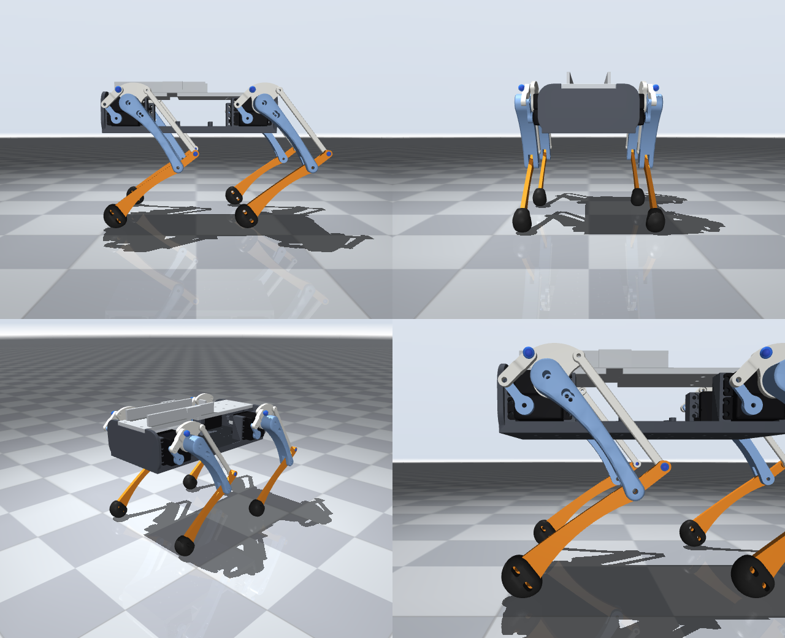

# 8-DoF Quadruped Robot

A 3D-printed 8-DoF quadruped robot that walks dynamically using IMU-based balance control,
inverse kinematics and coordinated gait generation, with RL training for terrain adaptation
planned.



## Repository

| Folder | |
|---|---|
| [`ros2_ws/`](ros2_ws) | ROS 2 Humble control software and MuJoCo simulation |
| [`cad/`](cad) | mechanical design (coming soon) |
| [`pcb/`](pcb) | electronics (coming soon) |

## Getting started

```bash
cd ros2_ws
pixi install
pixi run build
pixi run launch_sim
```

See [ros2_ws/README.md](ros2_ws/README.md) for details.

## License

[MIT](LICENSE)
