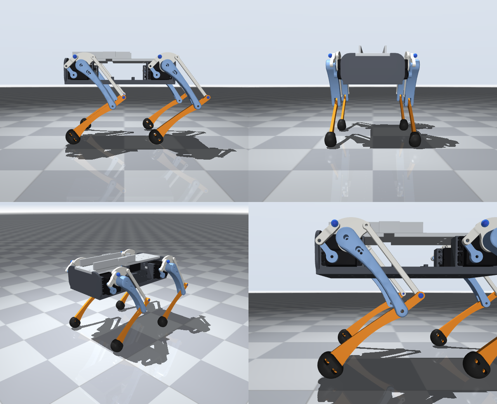

# Robot Dog Control (ROS 2)

ROS 2 Humble control stack for a small 8-DOF quadruped. Each leg is a planar five-bar
linkage driven by two 360° servos, and the robot runs on a Raspberry Pi 5.



## Features

- Five-bar leg kinematics with IK limited to a joint region computed from the CAD
- One data-driven gait generator; the commanded speed picks the gait
- Body height, pitch and roll control, IMU leveling and heading hold
- Startup envelope check and a per-tick front/rear leg collision guard
- Servo driver with clamp, rate limiter and watchdog
- MuJoCo simulation running the unchanged driver and controller
- Behavior API and PS5 gamepad teleoperation
- [Pixi](https://pixi.sh) workspace on `robostack-humble`, no system ROS install needed

## Hardware

Raspberry Pi 5 (Ubuntu 24.04), 8 × Feetech FT6335 servos on a PCA9685, and a BNO055 IMU.
See [docs/hardware.md](docs/hardware.md).

## Packages

| Package | |
|---|---|
| `robot_dog_hw` | PCA9685 servo driver node, IMU supervisor, servo tools |
| `robot_dog_control` | kinematics, gait, pose, controller node, behavior API, gamepad, calibration tools |
| `robot_dog_bringup` | launch files and `config/robot_dog.yaml`, the only configuration file |
| `robot_dog_description` | URDF, meshes, collision set, 3D view |
| `robot_dog_sim` | MuJoCo model and sim node |
| `ext/smbus_compat` | `smbus` shim for the BNO055 driver |

## Quick start (simulation)

```bash
pixi install
pixi run build
pixi run test
pixi run launch_sim
```

Connect [Foxglove](https://foxglove.dev) to `ws://localhost:8765` and import
`src/robot_dog_description/foxglove/robot_dog_layout.json`. In another shell:

```bash
pixi run walk_test -- --speed 0.08 --duration 5
```

## On the robot

```text
pixi run deploy
robotdog> config
robotdog> pixi run build
robotdog> pixi run launch_bringup
```

See [docs/bringup.md](docs/bringup.md) for first power-up and calibration.

## Documentation

- [Hardware](docs/hardware.md)
- [Bring-up and calibration](docs/bringup.md)
- [Control](docs/control.md)
- [Safety](docs/safety.md)
- [Robot model and joint limits](docs/model.md)
- [Simulation](docs/simulation.md)

## License

[MIT](../LICENSE)
